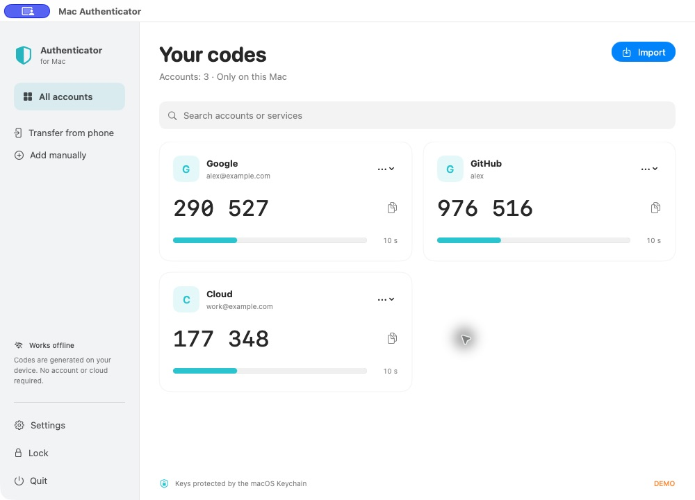

# Mac Authenticator

[](https://github.com/Rai220/google_auth_mac/actions/workflows/build.yml)

**English** · [Русский](README.ru.md) · [**Download for macOS**](https://github.com/Rai220/google_auth_mac/releases/latest)

A native, offline authenticator for **macOS 14+**, built with SwiftUI. Import your Google Authenticator accounts and generate codes on your Mac. No registration, server, analytics, cloud sync, or third-party runtime dependencies.



*Actual application screenshot in demo mode. All accounts and keys are synthetic; no personal data is shown.*

## Download and install

Choose a package from the [latest release](https://github.com/Rai220/google_auth_mac/releases/latest):

- **Apple Silicon:** `arm64`.
- **Intel Mac:** `x86_64`.

Open the DMG and drag **Mac Authenticator** into Applications, or extract the ZIP and move the app there. Each release includes `SHA256SUMS.txt` for download verification.

**Signing:** releases are ad-hoc signed, without Apple Developer ID signing or notarization. macOS may require **System Settings → Privacy & Security → Open Anyway** on first launch. Use this only after verifying that your download came from this repository. Managed Macs may prohibit running such apps.

## Import your accounts

On your phone, open Google Authenticator and choose **Transfer accounts → Export accounts**. In Mac Authenticator, click **Import**, then add every QR code in the export:

- **Open file…** — PNG/JPEG/HEIC and other ImageIO-supported images, or a text file with one export link per line.
- **From clipboard** — a QR image, `otpauth-migration://` link, or `otpauth://` link.
- **Camera** — show each QR code in sequence. macOS asks for camera access on first use.
- Drag images or text files into the main window.

The import preview lists the accounts and any missing QR codes. Click **Add** when all parts are present. Export versions 1 and 2 are supported, including version 2 without a batch ID and accounts without names. Import one export batch at a time: Google may omit its identifier. Duplicate credentials are skipped, preserving existing HOTP counters.

Use **Add manually** for an individual secret. Supported options: TOTP/HOTP, SHA-1/SHA-256/SHA-512, 6 or 8 digits, and a configurable TOTP period. MD5 and unknown parameters are rejected. Standard Google exports use a 30-second period.

Click a code to copy it for 30 seconds. The clipboard is cleared only if the app still owns its contents. **Next code** advances and saves a HOTP counter. Keep your Mac’s clock accurate for TOTP codes. Rename a service or account through its card menu.

| Shortcut | Action |
| --- | --- |
| `⌘I` | Import |
| `⌘O` | Open a file |
| `⇧⌘V` | Import from clipboard |
| `⇧⌘L` | Lock |
| `⌘,` | Settings |
| `⌘Q` | Quit |

The sidebar also includes **Settings** and **Quit**. Close settings with **Done** or Escape; changes are saved automatically.

## Language and authentication

In **Settings → Language**, select **Follow system**, **English**, or **Русский**. The app initially follows the system language (Russian for a Russian system, English otherwise). An explicit choice takes effect immediately and survives restarts. Account names are preserved. macOS-owned dialogs and standard menus follow the system’s app language settings.

**Require Touch ID or macOS password** is **off by default**. Enable it in Settings if you want confirmation when opening or unlocking the app. With protection enabled, codes are hidden at startup, after sleep, after switching users, and when manually locked. Unlock before changing this protection setting.

With protection off, accounts open without additional authentication; **Show codes** also reveals a manually locked vault without a prompt. macOS Keychain access prompts after an app signature change are controlled by macOS, independently of this setting.

## Storage and privacy

Accounts and secrets are stored in a single macOS Keychain Generic Password item (`local.macauthenticator.vault.v1`, account `accounts`) with `WhenUnlockedThisDeviceOnly` accessibility and no iCloud synchronization. No plaintext JSON vault or secrets in UserDefaults are created. A read failure blocks writes to protect existing data.

Keychain protection belongs to the current macOS user; the app does not isolate secrets from an administrator or a compromised system. Swift does not guarantee physical zeroing of every memory copy.

Export QR codes contain secret keys: do not publish them. The app does not create a backup. Keep access to your original authenticator or service recovery codes until you have verified the transfer. Removing the app does not delete its Keychain item.

## Build and test

Apple Command Line Tools with Swift 6 are sufficient; the Xcode IDE is not required:

```sh
python3 scripts/make-fixtures.py --check
python3 scripts/check-localization.py
swift run AuthenticatorChecks
swift run AuthenticatorStateChecks
./scripts/build-app.sh
./scripts/package-release.sh
```

The app is built at `dist/Mac Authenticator.app`; ZIP/DMG packages and checksums appear in `dist/releases/`. `VERSION` is the version source of truth. Builds use the host architecture unless `APP_ARCH=arm64` or `APP_ARCH=x86_64` is specified. Scripts do not install the app or change existing accounts. Builds are ad-hoc signed; macOS may ask to grant a new build access to the existing Keychain item.

`AuthenticatorChecks` is an executable suite that does not require XCTest. It covers RFC 4226/6238 vectors, Base32, URI parameters, protobuf, batches, duplicates, malformed input, the QR-to-code flow, and Keychain operations in a temporary namespace. `AuthenticatorStateChecks` checks optional authentication, language selection, persistence, interpolation, and preservation of account data.

Fixtures are synthetic. Regenerate them with `python3 scripts/make-fixtures.py`. Generate a test QR image with:

```sh
QR_FIXTURE_OUTPUT="$PWD/Tests/AuthenticatorCoreTests/Fixtures/migration.png" swift run AuthenticatorChecks
```

Validate an import locally without saving or printing account names or secrets:

```sh
swift run AuthenticatorChecks --inspect-import /path/to/qr1.png /path/to/qr2.png
```

`MacAuthenticator --demo` uses in-memory accounts with public test keys and never reads or writes the real vault. The README screenshot is captured from this mode.

## Automated builds and releases

Pushes to `main` and pull requests run tests and package builds on native Apple Silicon and Intel GitHub Actions runners. Workflow artifacts are retained for 14 days; manual runs are also supported.

For a release, update `VERSION` (`MAJOR.MINOR.PATCH`), commit, wait for successful CI, then tag that commit:

```sh
git tag -a "v$(cat VERSION)" -m "Mac Authenticator $(cat VERSION)"
git push origin "v$(cat VERSION)"
```

The tag must match `VERSION`. After both architecture jobs pass, the workflow creates a draft, uploads four packages and `SHA256SUMS.txt`, then publishes it. Published versions are never overwritten. Only the publishing job has `contents: write`; it uses the built-in `GITHUB_TOKEN`.

See [AGENTS.md](AGENTS.md) for development and secret-handling rules. Never include real exports in commits, artifacts, or reports.

## Format references

- [Google: transfer authenticator accounts](https://support.google.com/accounts/answer/1066447?hl=en)
- [Google: Key URI Format](https://github.com/google/google-authenticator/wiki/Key-Uri-Format)
- [Export protobuf reconstruction](https://github.com/qistoph/otp_export/blob/master/OtpMigration.proto) — an unofficial reconstruction, not a stable Google API.
- [RFC 4226](https://www.rfc-editor.org/rfc/rfc4226) and [RFC 6238](https://www.rfc-editor.org/rfc/rfc6238).

An independent application, not a Google product. Import does not require decompilation or a direct connection to your phone.
